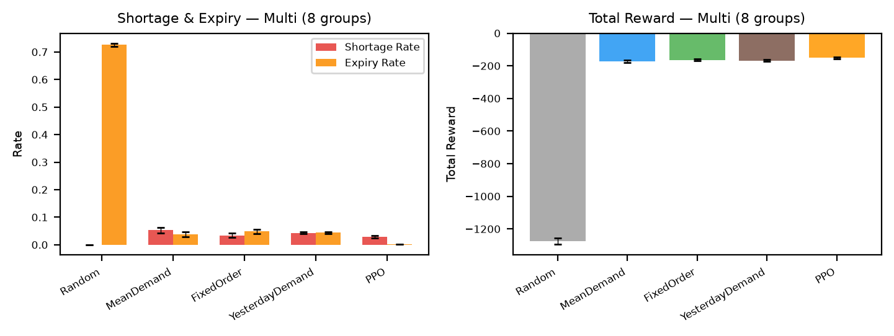
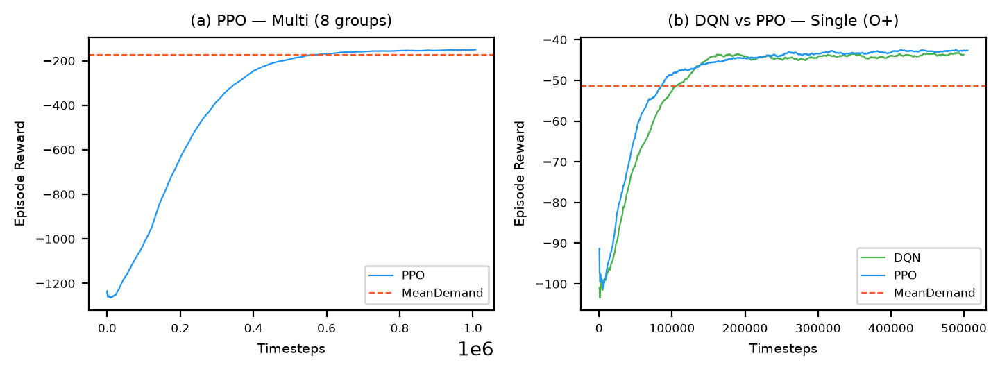
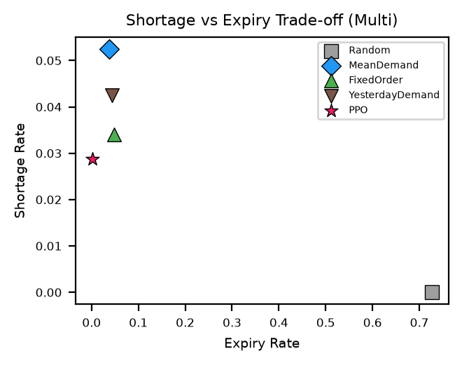

# Blood Bank Inventory Control with Reinforcement Learning

**AI Course — Assignment 2, IIT Jodhpur**

**Team:** Harsh Chaudhari (B24CM1027) · Aditya Gaurav (B24CM1003)

---

## Problem Description

A hospital blood bank stocks **platelets** for 8 blood groups (O+, O−, A+, A−, B+, B−, AB+, AB−). Platelets expire within 5 days, so ordering too many wastes units and ordering too few leads to critical shortages. Each day the agent observes current stock (by shelf-life), the incoming pipeline, 7 days of demand history, and the day of week, then decides how many units of each group to order from the regional blood centre. Orders arrive the next day with stochastic remaining shelf life.

## MDP Formulation

| Component | Description |
|-----------|-------------|
| **State** | Stock matrix (G×5 shelf-life), pipeline (G), demand history (G×7), day-of-week one-hot. Dim = 111 (multi) or 20 (single). |
| **Action** | Units to order per group: `MultiDiscrete([26]×8)` (multi) or `Discrete(26)` (single). |
| **Reward** | `−0.01 × (10·shortage + 0.5·substituted + 3·expired + 0.1·stock + 1·ordered)` |
| **Dynamics** | Orders arrive next day; demand sampled from negative binomial; FIFO issuing; substitution for compatible groups; expiry and ageing. |
| **Episode** | 365 days (1 year), starting on a Monday. |

## Demand Calibration

Demand is **simulated, not from a dataset**, calibrated from published hospital statistics:
- **Overdispersion**: Variance/mean = 12.3/5.4 ≈ 2.28, modelled with negative binomial (Canadian hospital study, [arXiv:2307.09395](https://arxiv.org/abs/2307.09395))
- **Weekly pattern**: Day-of-week mean total demand from UCLH platelet data ([arXiv:2411.14939](https://arxiv.org/abs/2411.14939)): Mon 28.8, Tue 33.4, Wed 26.2, Thu 28.4, Fri 30.8, Sat 18.6, Sun 19.6
- **Blood group shares**: Approximate Indian population distribution ([Agrawal et al., 2014](https://doi.org/10.4103/0973-6247.137452))

## Repository Structure

```
blood-bank-rl/
├── env/                    # Gymnasium environment (Harsh)
│   ├── config.py           # Shared constants
│   ├── blood_bank_env.py   # BloodBankEnv
│   ├── demand.py           # Negative binomial demand model
│   ├── wrappers.py         # DiscreteActionWrapper
│   └── rollout.py          # run_episode()
├── baselines/              # Heuristic policies (Harsh)
│   └── policies.py         # Random, MeanDemand, FixedOrder, YesterdayDemand
├── agents/                 # RL agents (Aditya)
│   ├── sb3_policy.py       # SB3 → policy.act() adapter
│   ├── train_ppo.py        # PPO training
│   └── train_dqn.py        # DQN training
├── evaluate.py             # Evaluate all policies (Aditya)
├── plots/make_plots.py     # Generate all figures (Aditya)
├── run_all.sh              # Full pipeline script (Aditya)
├── tests/test_env.py       # Environment tests (Harsh)
├── scripts/                # Utility scripts (Harsh)
├── models/                 # Trained models (.zip)
├── results/                # CSV, JSON, markdown outputs
├── figures/                # PNG figures
└── requirements.txt
```

## Installation

```bash
# Clone and set up
git clone https://github.com/harsh-c-16/blood-bank-rl.git
cd blood-bank-rl
python -m venv .venv

# Activate (choose one)
source .venv/bin/activate        # Linux/macOS/Git Bash
.venv\Scripts\activate           # Windows PowerShell

pip install -r requirements.txt
```

**Requires Python 3.10+.**

## Execution

### Full pipeline (with training)
```bash
bash run_all.sh
```

### Skip training (use committed models)
```bash
SKIP_TRAIN=1 bash run_all.sh
```

### Individual commands
```bash
# Run tests
python -m pytest -q

# Train RL agents
python -m agents.train_ppo --mode multi --timesteps 1000000 --seed 41
python -m agents.train_ppo --mode single --timesteps 500000 --seed 47
python -m agents.train_dqn --timesteps 500000 --seed 53

# Evaluate all policies
python -m evaluate

# Generate figures
python -m plots.make_plots
```

## Results

Results below are means over 30 evaluation seeds (1000--1029); values are mean ± standard deviation. Full metrics are in `results/eval_summary.md`.

The active trained models are `models/ppo_multi.zip`, `models/ppo_single.zip`, and `models/dqn_single.zip`. The multi-group PPO uses the original observation scale; observation normalization produced worse held-out results in our comparison.

### Multi mode (eight groups)

| Policy | Total reward | Shortage rate | Expiry rate |
|---|---:|---:|---:|
| Random | -1275.5 ± 18.7 | 0.0000 ± 0.0001 | 0.7261 ± 0.0054 |
| MeanDemand | -172.6 ± 8.7 | 0.0524 ± 0.0103 | 0.0373 ± 0.0090 |
| FixedOrder | -163.6 ± 7.0 | 0.0341 ± 0.0081 | 0.0481 ± 0.0088 |
| YesterdayDemand | -167.5 ± 4.4 | 0.0425 ± 0.0033 | 0.0437 ± 0.0035 |
| PPO (1M steps) | -151.4 ± 4.8 | 0.0288 ± 0.0043 | 0.0021 ± 0.0007 |

### Single mode (O+)

| Policy | Total reward | Shortage rate | Expiry rate |
|---|---:|---:|---:|
| Random | -102.7 ± 6.9 | 0.0055 ± 0.0048 | 0.3033 ± 0.0289 |
| MeanDemand | -51.3 ± 4.1 | 0.0348 ± 0.0141 | 0.0332 ± 0.0115 |
| FixedOrder | -51.1 ± 3.1 | 0.0214 ± 0.0114 | 0.0498 ± 0.0133 |
| YesterdayDemand | -44.0 ± 2.4 | 0.0171 ± 0.0048 | 0.0180 ± 0.0044 |
| DQN (500k steps) | -42.7 ± 1.7 | 0.0105 ± 0.0043 | 0.0197 ± 0.0072 |
| PPO (500k steps) | -41.5 ± 1.8 | 0.0097 ± 0.0049 | 0.0120 ± 0.0055 |

The baselines are simple ordering rules: random orders, the mean demand of the arrival day, a fixed daily order equal to the average demand, and yesterday's demand. The 1M-step vanilla PPO substantially improves on the previous VecNormalize multi-group run (reward -473.5, shortage rate 0.4110) and beats every baseline; against the best baseline (FixedOrder) it gains 12.2 reward points per episode (95% paired CI +9.3 to +15.1, better on 26 of 30 seeds) and has far lower expiry. In single mode PPO beats the best baseline (YesterdayDemand) by 2.5 points (CI +1.8 to +3.3) and DQN by 1.3 points (CI +0.6 to +2.0). Longer single-group training modestly lowers shortage for PPO and DQN, but reward differences from the earlier 200k models are small and not clearly significant across the 30 paired seeds. The figures in `figures/` visualize these comparisons.

Training variants and paired-seed comparisons are documented in `results/model_comparison.md`.







## Reproducibility

- **Training seeds**: each training env is seeded with 100 × `--seed` + env index (4100–4107 multi PPO, 4700–4707 single PPO) and DQN with 53, so training never uses the reserved or evaluation seeds
- **Tuning seeds**: 500–519 (reserved, not used for training or evaluation)
- **Evaluation seeds**: 1000–1029 (30 independent 365-day episodes)
- All randomness is seeded through `env.reset(seed=...)` and SB3 model seeds; `reset()` without a seed continues the seeded stream
- Trained models are committed to `models/` for exact reproduction with `SKIP_TRAIN=1`

## References

1. Abouee-Mehrizi et al. "Platelet Inventory Management with Approximate Dynamic Programming." arXiv:2307.09395, 2023.
2. Farrington et al. "Many happy returns: machine learning to support platelet issuing and waste reduction in hospital blood banks." arXiv:2411.14939, 2024.
3. Schulman et al. "Proximal Policy Optimization Algorithms." arXiv:1707.06347, 2017.
4. Mnih et al. "Human-level control through deep reinforcement learning." Nature 518, 529–533, 2015.
5. Raffin et al. "Stable-Baselines3: Reliable Reinforcement Learning Implementations." JMLR 22(268), 2021.
6. Agrawal et al. "ABO and Rh(D) group distribution and gene frequency; the first multicentric study in India." Asian J Transfus Sci 8(2), 121–125, 2014.
